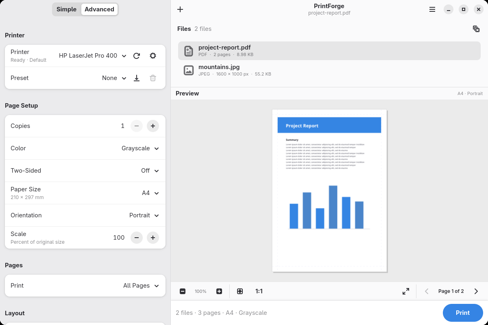
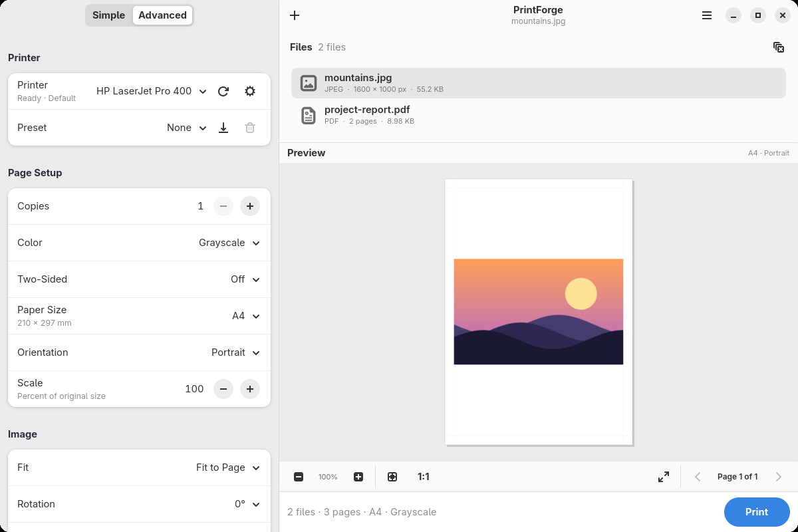

# PrintForge

**A modern desktop printing app for Linux, built with GTK4 and libadwaita.**

PrintForge makes printing a file as simple as dropping it on a window, while still giving you full
control: a live preview of exactly what will come out of the printer, every layout option in one
place, and tools that explain and fix common printer problems.




## Why PrintForge?

Printing from Linux often means opening a file in one app just to reach its print dialog, guessing
how the page will be scaled, and digging into the CUPS web interface when something goes wrong.
PrintForge is a single place to print any common file type with an accurate preview, and to
understand and repair the printer when it misbehaves.

## Features

**Files**
- Images (PNG, JPEG, WebP, BMP, TIFF, GIF and more), SVG, PDF, PostScript/EPS
- Office documents (Word, Excel, PowerPoint, OpenDocument, RTF) via LibreOffice
- Plain text, Markdown and source code, with optional syntax highlighting
- Queue several files by drag and drop or the file picker, and print them together

**Preview and layout**
- Live preview that matches the selected paper, orientation, margins and scaling
- Fit to page, fill page, actual size or a custom scale
- Margins, 9-point positioning, pages per sheet (N-up), booklet and poster printing
- Page ranges such as `1-3, 5, 8-10`
- A summary bar that counts files, pages and sheets exactly as they will print

**Printer control**
- Automatic printer discovery through CUPS with live status
- Copies and collation, color or grayscale, two-sided printing, quality and resolution
- Paper sizes, media types and input trays taken from the printer's own driver
- Saved presets, print history, and checks before printing that catch common mistakes

**Printer settings and repair** (gear button next to the printer)
- Plain-language status: paper out, jams, low toner, paused or offline, plus supply levels
- One-click diagnosis of the print service, connection, queue and driver, with a fix beside each finding
- Test, alignment and cleaning pages, and the driver's own maintenance commands where available
- Changes that need administrator rights go through the system password prompt (polkit)

**Command line**
- Print or export a print-ready PDF from scripts without opening the window

<p align="center"></p>

## Requirements

- Linux with a graphical desktop (developed and tested on Fedora 44)
- Python 3.10 or newer
- GTK 4 and **libadwaita 1.7 or newer** (Fedora 42+, Ubuntu 25.04+, Debian 13+)
- CUPS, running locally or reachable on the network

| Purpose | Fedora package |
|---|---|
| Required | `python3-gobject gtk4 libadwaita python3-cairo python3-pillow python3-cups poppler-glib librsvg2` |
| Local print service | `cups` |
| Syntax highlighting (optional) | `python3-pygments` |
| PostScript/EPS files (optional) | `ghostscript` |
| Office documents (optional) | `libreoffice-core` |

On other distributions, install the equivalent packages. The GObject introspection data for
GTK 4, libadwaita, Poppler and librsvg must be present.

## Installation

### 1. Install the system packages

```bash
sudo dnf install python3-gobject gtk4 libadwaita python3-cairo python3-pillow \
                 python3-cups poppler-glib librsvg2 cups
# Optional extras
sudo dnf install python3-pygments ghostscript libreoffice-core
```

Make sure the print service is running:

```bash
sudo systemctl enable --now cups
```

### 2. Get PrintForge

```bash
git clone https://github.com/peteriishak/PrintForge.git
cd PrintForge
```

### 3. Run it

**From the source tree (no installation):**

```bash
python3 -m printforge
```

**Or install it for your user:**

```bash
python3 -m pip install --user --no-deps .
printforge
```

`--no-deps` keeps pip from rebuilding PyGObject, pycairo and pycups from source; the system packages
from step 1 already provide them. To add PrintForge to the app grid, also install the desktop entry
and icons:

```bash
install -Dm644 data/io.github.peteriishak.PrintForge.desktop -t ~/.local/share/applications/
cp -r data/icons ~/.local/share/
```

**Or build an RPM (Fedora):**

```bash
sudo dnf install rpm-build pyproject-rpm-macros python3-devel python3-wheel \
                 desktop-file-utils libappstream-glib
mkdir -p ~/rpmbuild/SOURCES
git archive --prefix=PrintForge-1.0.0/ -o ~/rpmbuild/SOURCES/printforge-1.0.0.tar.gz HEAD
rpmbuild -ba printforge.spec
sudo dnf install ~/rpmbuild/RPMS/noarch/printforge-1.0.0-*.rpm
```

## Usage

Open PrintForge, drop files onto the window (or press <kbd>Ctrl</kbd>+<kbd>O</kbd>), choose a
printer and settings in the sidebar, check the preview, and press **Print**. The **Simple** /
**Advanced** switch at the top of the sidebar shows everyday settings or every option.

You can also pass files on the command line:

```bash
printforge report.pdf photo.jpg        # open files in the window
printforge --mock                      # demo printers, no CUPS needed
printforge --debug                     # verbose logging
```

### Command-line printing

```bash
# Print a PDF two-sided in grayscale
printforge --no-gui --printer "Office_Laser" --paper A4 --grayscale --duplex long-edge report.pdf

# Three copies of a photo in high quality
printforge --no-gui --printer "Office_Laser" --copies 3 --quality high photo.png

# Write the exact print-ready PDF instead of printing (no printer needed)
printforge --export-pdf out.pdf --paper Letter --landscape slides.pdf
```

List your printer names with `lpstat -p`. Run `printforge --help` for every option. When running
from source, use `python3 -m printforge` in place of `printforge`.

### Keyboard shortcuts

| Shortcut | Action |
|---|---|
| <kbd>Ctrl</kbd>+<kbd>O</kbd> | Add files |
| <kbd>Ctrl</kbd>+<kbd>P</kbd> | Print |
| <kbd>Ctrl</kbd>+<kbd>R</kbd> | Refresh printers |
| <kbd>Delete</kbd> | Remove the selected file |
| <kbd>Ctrl</kbd>+<kbd>Shift</kbd>+<kbd>P</kbd> | Print queue |
| <kbd>Ctrl</kbd>+<kbd>,</kbd> | Preferences |
| <kbd>Ctrl</kbd>+<kbd>Q</kbd> | Quit |

## Configuration

PrintForge needs no configuration. Preferences, presets and print history are stored as JSON in
`~/.config/printforge/` (or `$XDG_CONFIG_HOME/printforge/`). Delete that folder to reset everything.

Under **Preferences → Printing** you can set the **User ID** shown on the printer's display and job
log. It defaults to the computer's name. For PostScript printers that read PJL job commands (Ricoh,
HP and similar) behind a generic driver, PrintForge adds the User ID to the job itself.

## Troubleshooting

| Problem | What to do |
|---|---|
| `ValueError: Namespace Adw not available` or `'gi.repository.Adw' object has no attribute 'ToggleGroup'` | libadwaita is missing or older than 1.7. Install or upgrade `libadwaita`. |
| `ModuleNotFoundError: No module named 'cups'` | Install `python3-cups`. Without it PrintForge cannot reach CUPS. |
| No printers are listed | Check `systemctl status cups` and `lpstat -p`. Add printers in your system settings, then press <kbd>Ctrl</kbd>+<kbd>R</kbd>. Use `--mock` to try the app without a printer. |
| A printer is listed but nothing prints | Open the printer settings (gear button), go to **Repair** and run the check. It finds paused printers, stuck jobs and connection problems and offers fixes. |
| Office documents won't open | Install LibreOffice (`libreoffice-core`); PrintForge uses it to convert them. |
| PostScript/EPS files won't open | Install `ghostscript`. |
| Code prints without colors | Install `python3-pygments`. |
| Something else | Run `printforge --debug` and include the output when you open an issue. |

## Development

```bash
sudo dnf install python3-pytest
python3 -m pytest
```

The test suite covers layout and page counting, paper sizes and units, document loading and
rendering, print settings, presets, CUPS option mapping, driver options, PJL headers, diagnostics
and the mock backend. Start the app with `--mock` to work on the UI without a real printer.

### Project layout

```
printforge/
  __main__.py          command-line entry point (GUI, CLI printing, PDF export)
  application.py       Adw.Application: startup, CSS, window
  config/              print settings, app settings, presets, history
  documents/           loaders for each file type, layout engine, renderer,
                       booklet/poster imposition, print-ready PDF builder
  printing/            CUPS backend, mock backend, capabilities, driver (PPD) options,
                       PJL job headers, preflight checks, diagnostics and maintenance
  ui/                  main window, sidebar, preview, dialogs, printer settings, CSS
  utils/               paper sizes, unit conversion, formatting
data/                  desktop entry, AppStream metadata, icons
docs/screenshots/      images used in this README
tests/                 pytest suite
printforge.spec        RPM spec for Fedora
```

## Contributing

Bug reports, ideas and pull requests are welcome. See [CONTRIBUTING.md](CONTRIBUTING.md).

## License

PrintForge is free software, released under the
[GNU General Public License v3.0 or later](LICENSE).

Copyright © 2026 Peter Habib
